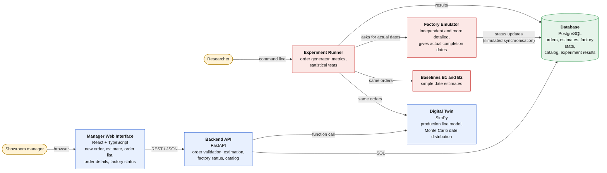

# Architecture Description

**Author:** Zhannur Meirambek

## 1. Purpose

This document describes how the system is built: which components it has, what each one is responsible for, and how they talk to each other. The component diagram is in [diagrams/component-diagram.png](../diagrams/component-diagram.png) (editable source: [diagrams/component-diagram.mmd](../diagrams/component-diagram.mmd), vector export: [diagrams/component-diagram.svg](../diagrams/component-diagram.svg)). Requirement IDs refer to [06-requirements.md](06-requirements.md), and technology choices are explained in [05-technology-comparison.md](05-technology-comparison.md).

## 2. Architecture Overview

The system has two parts that work with the same twin.

1. **The order management system** is what a showroom manager uses. The manager enters an order in a web interface. The backend validates it, asks the digital twin to simulate it in the current factory state, and returns a delivery-date range with reasons.
2. **The evaluation environment** is what we use to answer the research question. It generates many orders, gets an estimate for each one from the digital twin and from the two baselines B1 and B2, asks an independent factory emulator for the "actual" completion date, and compares the estimates with the actual dates.

The central idea of ​​the architecture lies in the separation of the "twin" from the emulator. The "twin" is a model that the system uses to generate estimates, while the emulator acts as the actual production environment. If the same model were used for both tasks, the "twin"—by virtue of its very structure—would always turn out to be correct. For this reason, the emulator is a distinct, more detailed program, and the "twin" never accesses either its source code or the random numbers it generates.

## 3. Components

| Component | Technology | Responsibility | Requirements |
|---|---|---|---|
| Manager Web Interface | React, TypeScript, Vite | Five screens for the manager: new order, evaluation result, order list, order details, production status. Displays the date range, the probability of meeting deadlines, and the reasons. Does not contain business logic. | FR-01, FR-04 to FR-08, NFR-02 |
| Backend API | FastAPI (Python) | A single entry point for the interface. Checks orders, saves them, interacts with the digital twin, returns estimates, reports on the production status, and provides a product catalog. | FR-01 to FR-08, FR-15, NFR-03 |
| Database | PostgreSQL, SQLAlchemy | Stores orders (in JSON format), estimates, information about the current state of production, product catalogs, and experimental results. | FR-03, FR-06, FR-07 |
| Digital Twin | SimPy (Python) | A discrete-event model of a production line (panel cutting, edge banding, drilling, machining on CNC machines, painting, warehousing) with random processing time intervals and downtime. Repeated simulation (Monte Carlo method) allows obtaining the distribution of production completion dates. | FR-04, FR-05, FR-09, FR-10 |
| Factory Emulator | Python | An independent stochastic model of the plant, more detailed than twin. It calculates the “actual” completion dates of the work for assessment and sends status updates that simulate the connection with the real plant. | FR-12 |
| Baselines B1 and B2 | Python | B1: average historical execution time plus a fixed buffer. B2: static throughput check without feedback. Provide comparative estimates for the same orders. | FR-11 |
| Experiment Runner | Python | Generates orders, runs twin, B1, B2, and the emulator on the same orders, calculates MAE, MAPE, bias, the share of profitable trades, and the evaluation time, performs statistical tests, and exports the data to CSV. | FR-13, FR-14, FR-16, NFR-04 |

### 3.1 Backend modules

Inside the backend we separate four small services so that each has one job.

| Module | What it does |
|---|---|
| Order Service | Validates the digital order against the schema and rules, creates and updates orders, changes status |
| Estimation Service | Loads the current factory state, calls the twin, builds the answer: earliest, most likely and latest date, probability for the requested date, main reasons |
| Factory Status Service | Reads the factory state from the database and returns load by station and orders in progress |
| Catalog Service | Returns products, materials and finishes allowed in an order |

### 3.2 Digital twin internals

| Part | Role |
|---|---|
| Production line model | Stations with limited capacity and queues, processing times as random variables, breakdowns, working hours, material availability |
| Monte Carlo runner | Runs the model many times (about 200 runs for one order) with different random numbers and collects the completion dates |
| State loader | Reads the factory state (orders in progress, queues, stock) from the input it receives and starts the model from that state |

## 4. Interfaces Between Components

| From | To | Interface | Data |
|---|---|---|---|
| Manager | Web Interface | Browser | Order form, estimate view |
| Web Interface | Backend API | REST over HTTP, JSON | Orders, estimates, status, catalog. The API is described by OpenAPI documentation generated by FastAPI |
| Backend API | Database | SQL through SQLAlchemy | Orders, estimates, factory state |
| Backend API (Estimation Service) | Digital Twin | Python function call in the same process | Input: digital order and factory state. Output: list of simulated completion dates and the main delays |
| Factory Emulator | Database | SQL | Status updates of orders in the simulated factory |
| Researcher | Experiment Runner | Command line | Scenario settings, number of replications, random seed |
| Experiment Runner | Digital Twin, Baselines, Emulator | Python function calls | Same orders to the twin and the baselines. Request of actual dates from the emulator |
| Experiment Runner | Database / CSV | SQL and files | Estimates, actual dates, metrics, test results |

The main digital order format is the JSON schema from [06-requirements.md](06-requirements.md), Section 6. All components use the same schema, so an order created by the manager and an order generated for an experiment look the same to the twin.

## 5. Main Flow: Estimating an Order

1. The manager fills in the new-order form and presses the estimate button.
2. The Web Interface sends `POST /orders/estimate` with the digital order.
3. The Order Service validates the order. If it is invalid, the API answers with a 4xx code and a clear message (FR-02, NFR-03).
4. The Estimation Service loads the current factory state from the database.
5. It calls the Monte Carlo runner of the digital twin with the order and the state (FR-10).
6. The twin simulates the order about 200 times and returns the completion dates and the stations that caused most of the delay.
7. The Estimation Service converts the result into earliest, most likely and latest date, the probability of meeting the requested date and the list of reasons (FR-04, FR-05).
8. The API returns the estimate and the interface shows it. The estimate is stored with the order.
9. If the manager agrees with the date, they confirm it. The Web Interface sends `POST /orders` with the committed date and the order is saved with status `confirmed` (FR-06).

The target for steps 2–8 is 10 seconds or less (NFR-01).

## 6. Main Flow: Experiment

1. The researcher starts the Experiment Runner module by setting a scenario (load level, disturbance parameters, number of repetitions, initial value of the random number generator).
2. The module generates orders for the selected scenario and determines the initial state of the production system.
3. For each order, the system receives ratings from digital counterparts B1 and B2 (FR-11).
4. The system requests the Factory Emulator to complete the same order within a given scenario and receives the actual completion date (FR-12).
5. Upon completion of all repetitions, the system calculates the indicators MAE, MAPE, bias, the proportion of orders completed on time, as well as the time spent on obtaining estimates for each of the methods (FR-14).
6. The system performs a statistical comparison (using the Wilcoxon landmark rank criterion with Holm correction) and exports the resulting tables in CSV format (FR-16).

Because the seed is fixed, the whole experiment can be repeated with the same result (NFR-04).

## 7. Deployment

Each part runs in its own Docker container started by Docker Compose (NFR-06):

| Container | Content |
|---|---|
| `frontend` | The built React application |
| `backend` | FastAPI with the digital twin as a Python package in the same process |
| `db` | PostgreSQL |
| `experiments` | Experiment Runner, baselines and emulator (started on demand, not with the main system) |

Tests (pytest) and checks run in GitHub Actions on every pull request (NFR-05).

## 8. Repository Structure and Components

The repository folders match the components:

| Folder | Component |
|---|---|
| `frontend/` | Manager Web Interface |
| `backend/` | Backend API and database access |
| `twin/` | Digital Twin |
| `emulator/` | Factory Emulator |
| `experiments/` | Experiment Runner, baselines, order generator, analysis |
| `docs/` | Documents |
| `diagrams/` | Diagram sources and exports |

## 9. Consistency with Other Diagrams

The context diagram and the use case diagram use the same names as this document so that the three views can be read together.

| Element | Name used in all diagrams |
|---|---|
| Actors | Showroom manager (creates and confirms orders, checks factory status), Researcher (runs experiments), Production planner (views factory status) |
| System boundary | Intelligent Order Management System |
| External source of factory data | Factory (simulated by the Factory Emulator) |
| Main use cases | Enter order, Get delivery-date estimate, Confirm order, View orders, View factory status, Run experiment |

How the use cases map to components:

| Use case | Components involved |
|---|---|
| Enter order | Web Interface, Backend API (Order Service), Database |
| Get delivery-date estimate | Web Interface, Backend API (Estimation Service), Digital Twin, Database |
| Confirm order | Web Interface, Backend API (Order Service), Database |
| View orders | Web Interface, Backend API, Database |
| View factory status | Web Interface, Backend API (Factory Status Service), Database |
| Run experiment | Experiment Runner, Digital Twin, Baselines, Factory Emulator, Database |

## 10. Design Decisions and Trade-offs

| Decision | Reason | Trade-off |
|---|---|---|
| Twin runs inside the backend process as a function call | Simple, fast and easy to test, no network between the API and the twin | The twin cannot be scaled separately from the API |
| Emulator is separate from the twin | Keeps the evaluation honest: the twin is not tested against its own model | Two models must be built and kept consistent in basic facts (stations, shifts) |
| Interface contains no business logic | The same rules apply to the manager and to experiments | The interface depends on the API for all validation |
| Factory state is stored in the database | Both the backend and the emulator can update it, and the twin always starts from a known state | The state is updated by simulated messages, not by real machines |
| One database for orders and experiment results | One tool, one setup | Experiment data and order data share the same server |

## 11. Limitations

- The connection between the factory and the “simulator” is modeled. The emulator sends status updates, but there is no direct connection to the real machines.
- The model covers one product family and six production areas.
- The target performance indicator (NFR-01) has not yet been measured. It will be tested on the first version of the “simulator”.
- Pricing, engineering design, and production schedule optimization are not part of the architecture.
